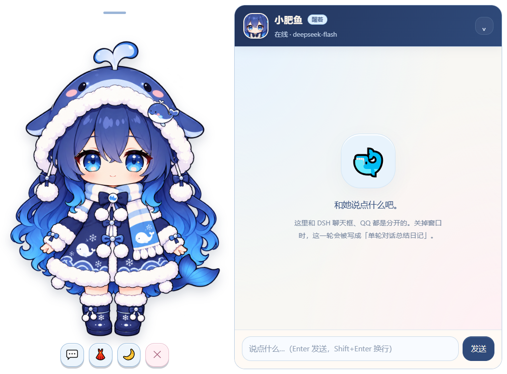
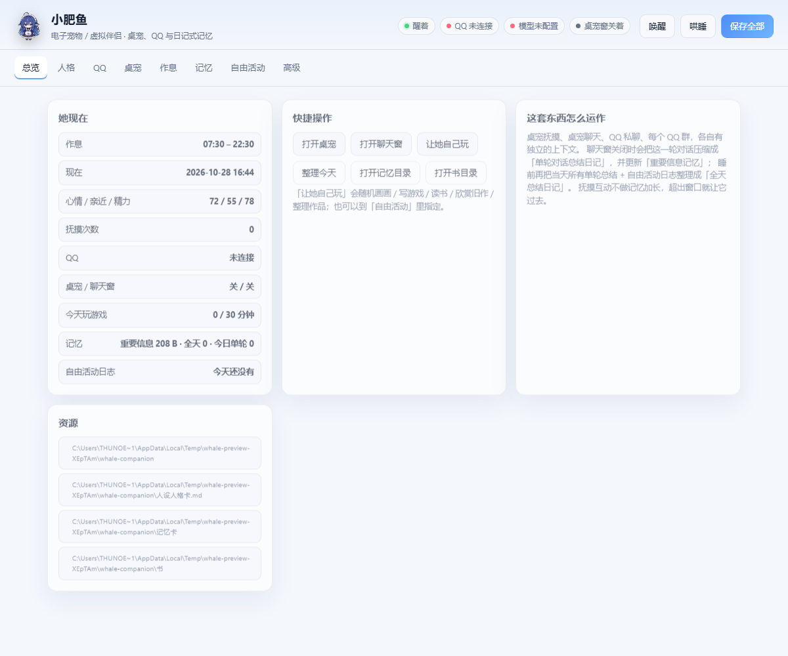

# dsh-whale-companion · 小肥鱼

> 给 DeepSeek Harness 装一条有作息、有记忆、会吃醋、会自己画画写游戏的小鲸鱼娘。
>
> 桌宠抚摸 · 聊天抽屉 · QQ 私聊/群聊 · 日记式长期记忆 · 自由活动。
>
> 参考了「养鱼」插件和 B 站上一些人机恋玩法的**思路**，但代码、协议和记忆结构都是为本插件单独写的；没有安装或复制任何第三方插件，也没有做 B 站私信/评论模块。

## 预览

| 桌宠 | 聊天抽屉（同一窗口） | 设置页 |
|---|---|---|
|  |  |  |

> 预览用的是 fallback 立绘。当前 Codex 交付的是 Canvas2D 分层 sprite 版（三套服装、17 种动作，已验收），不是 Cubism model3；真正的 Live2D 还需要在 Cubism Editor 里按 `pet/assets/live2d/BINDING.md` 绑定。

---

## 它是什么

- **桌宠**：一个独立的小窗口，三套服装（女仆 / 针织 / 冬装），摸头、捏耳朵、摸肚子、摸尾巴、戳脸、牵手都有不同反应；高兴、撒娇、转圈、喷水、炸毛、困倦等动作由 LLM 返回的动作标签驱动。
- **桌宠聊天抽屉**：和 DSH 聊天框完全独立，但和桌宠在同一个透明窗口里；左键抚摸、右键菜单，展开聊天不另开窗口。支持流式回复、插话打断、折叠时写总结。
- **QQ**：NapCatQQ（OneBot 11）WebSocket。只私聊主人，只回复最多三个群里 @ 她的消息；睡觉时断开，醒来只处理新消息；主人连发时打断上一条回复。
- **记忆**：人设人格卡固定；重要信息记忆一份；单轮对话总结日记 N 份；全天总结日记按天一份；自由活动日志每天一份。上下文窗口满时，最早的消息**原封不动**写进临时记忆文件，不是摘要、不是向量库；对话结束时才压缩成单轮总结，睡前再合成全天总结。
- **自由活动**：醒来后不忙时，自己画画（SVG）、写小游戏（单文件 HTML 或 Python，≤20KB）、读书（只读不删）、欣赏旧作、玩自己的游戏（每天 ≤30 分钟）、整理旧作品、主动想主人。
- **设置页**：DSH「设置 → 小肥鱼」里的完整设置；人设修改要连续确认三次。

---

## 快速开始

见 [INSTALL.md](INSTALL.md)。最短路径：

1. 把仓库放到 F 盘，例如：

   ```powershell
   git clone https://github.com/Maxwell345/dsh-whale-companion.git F:\DeepSeekBot\dsh-whale-companion
   ```

2. 运行便携安装脚本（只会在 C 盘 profile 里留一个 junction，插件代码/数据/Electron 都在 F 盘）：

   ```powershell
   powershell -ExecutionPolicy Bypass -File F:\DeepSeekBot\dsh-whale-companion\tools\install-portable.ps1
   ```

   然后安装 Electron：

   ```powershell
   powershell -ExecutionPolicy Bypass -File F:\DeepSeekBot\dsh-whale-companion\tools\install-electron.ps1
   ```

3. 重启 DSH。
4. 打开 **设置 → 小肥鱼**：
   - 填「人格」；
   - 「高级」里确认 DeepSeek Key（留空会自动尝试用 DSH 自己的 key）；
   - 按需填 QQ 和作息；
   - 点「保存全部」。
5. 点「打开桌宠」。第一次会启动 Electron 透明单窗口（需要先装 Electron 运行时，见下），左键摸、右键菜单、聊天抽屉都在同一个窗口里。
6. 当前 Live2D 是 Canvas2D sprite fallback；要真 Cubism，按 [CUBISM-TUTORIAL.md](CUBISM-TUTORIAL.md) 在 Cubism Editor 绑定导出，再把模型交给我接 `avatar-live2d.js`。

### PixiJS 不需要安装

PixiJS 是浏览器库，不是系统软件。`pet/live2d/vendor/` 里有：

- `pixi.min.js`（PixiJS 6.5.10，MIT）
- `pixi-live2d-display-cubism4.min.js`（pixi-live2d-display 0.4.0，MIT）
- `live2dcubismcore.min.js`（Live2D Cubism Core，官方 Latest）

**Cubism Core 有 Live2D 单独授权，已加入 `.gitignore`，不随公开仓库分发。** 想接真 Live2D 的贡献者需要自己从 Live2D 官方获取 Core，放到 `pet/live2d/vendor/live2dcubismcore.min.js`；当前 sprite 版不需要 Core。

---

## 目录结构

```text
dsh-whale-companion/
├─ lib/
│  ├─ index.js          # 宿主半：HTTP 路由、鉴权、服务装配
│  ├─ config.js         # 配置默认值 / 校验 / 人设保存（三次确认）
│  ├─ memory.js         # 对话窗口、临时记忆、单轮总结、重要信息、全天总结
│  ├─ llm.js            # DeepSeek Chat Completions（流式 / 非流式）
│  ├─ pet.js            # 抚摸互动、心情/亲近/精力、动作解析
│  ├─ qq.js             # OneBot 11 WebSocket 客户端
│  ├─ schedule.js       # 生物钟、手动唤醒/哄睡
│  ├─ activities.js     # 自由活动、作品校验、游戏时长
│  ├─ window-shell.js   # Electron 透明单窗口 + Edge fallback
│  └─ client.js         # DSH 设置 section（iframe 壳）
├─ web/
│  ├─ settings.html/js  # 完整设置页
│  ├─ pet.html/js/css   # 透明桌宠 + 聊天抽屉 + 右键菜单
│  ├─ chat.html/js/css  # 聊天抽屉内容（也可独立打开）
│  ├─ activity.html/js  # 看画 / 玩游戏
│  ├─ avatar-fallback.js# 立绘 fallback（实现 window.WhaleAvatar）
│  └─ ui.css / ui.js
├─ pet/
│  ├─ assets/           # 立绘 / sprite 素材
│  ├─ electron-app/     # Electron 透明壳 main/preload
│  └─ live2d/           # avatar.js + models（当前为 sprite 版）
├─ docs/                # 预览截图
├─ tools/
│  ├─ install-electron.ps1 # 下载 Electron 到 whale-companion/pet-shell
│  ├─ install-portable.ps1 # 插件放 F 盘，C 盘只留 junction
│  ├─ pet-window.ps1    # Edge fallback 的 Win32 壳
│  ├─ make-assets.py    # 从参考图生成立绘
│  └─ selftest.mjs
├─ tests/
├─ CODEX-PROMPT.md      # 发给 Codex 的 Live2D/UI 提示词
├─ persona-template.md  # 人设模板（自己改完再填）
└─ INSTALL.md
```

运行时数据**优先**放在 `F:\DeepSeekBot\whale-companion\`；如果目标机器没有 F 盘/不可写，才回退到 `%USERPROFILE%\.dsh\whale-companion\`。可以用 `WHALE_DATA_DIR` 覆盖。当前这台机器上，`%USERPROFILE%\.dsh\whale-companion` 是指向 F 的 junction；旧数据备份在 `%USERPROFILE%\.dsh\whale-companion.old`，确认无误后可删：

```text
人设人格卡.md
记忆卡/
  重要信息记忆.md
  全天总结日记/YYYY-MM-DD.md
  单轮对话总结日记/YYYY-MM-DD-HHMM-标题.md
  自由活动日志/YYYY-MM-DD.md
  临时记忆/<对话>.jsonl
对话历史/<对话>.jsonl
自由活动/画/*.svg
自由活动/游戏/*.html|*.py
书/*.txt
日志/whale.log
状态.json
桌宠状态.json
窗口缓存/
```

桌宠和 QQ 共用这一个目录，所以人设和记忆是同一份。

---

## 记忆是怎么走的

### 1. 普通对话（桌宠聊天 / QQ 私聊 / 每个 QQ 群）

每个通道有独立的 `Conversation`：

```text
system = 人设 + 重要信息 + 最近全天总结 + 今天的单轮总结 + 临时记忆的最近原文 + 当前状态 + 通道规矩
messages = system + 当前上下文窗口
```

- 发送前估算 token；如果 `system + 窗口` 超过 `contextLimit - maxTokens`，从**最前面**开始，把消息逐条原样写入 `记忆卡/临时记忆/<对话>.jsonl`，然后从窗口移除。
- 请求时会把临时记忆文件末尾几轮原文拼进 system，作为“更早的对话存档”，让上下文能接上。
- 这不是摘要、不是 RAG、不是向量库；写进临时文件的每一个字都是原文。

### 2. 对话结束（聊天抽屉折叠 / 桌宠关闭 / QQ 空闲 / 睡觉）

- 读取**完整对话文件**（包括已经写进临时记忆的最早几轮）。
- 调 LLM 压缩成一份 `单轮对话总结日记`（300–800 字，保留主人透露的事实）。
- 用这份总结更新 `重要信息记忆`（只有一份，长期保留）。
- 删除临时记忆文件；完整对话文件改名为 `已归档-...jsonl`（可在设置里关掉保留）。
- 单轮总结留在 `单轮对话总结日记/`，供当天后续对话动态读取。
- 聊天抽屉的「折叠」就是这个动作：写总结、清空；再次展开是新的对话，旧历史不回来。
- 关闭整个桌宠窗口时，会先自动折叠聊天，再退出。

### 3. 睡觉（生物钟到点 / 手动哄睡）

1. 折叠聊天抽屉；
2. 断开 QQ；
3. 关闭桌宠互动，清空抚摸上下文；
4. 把当天所有未结束的对话做单轮总结；
5. 收集当天 N 份单轮总结 + 1 份自由活动日志，合成 `全天总结日记/YYYY-MM-DD.md`；
6. 删除这些单轮总结和自由活动日志；
7. 把超过 14 天的旧全天总结压缩进「重要信息记忆」，删掉旧日记；
8. 进入睡眠。

第二天醒来，对话只读取「重要信息记忆 + 最近的全天总结」，不再看前一天的临时文件。

### 4. 抚摸互动（按天保留）

`pet-touch` 是单独的短上下文（最多 24 条），**不做**临时记忆、不做单轮总结、不做全天总结。抚摸只影响心情/亲近/精力，不污染聊天记忆。

- 同一天内关闭桌宠、重开、甚至重启 DSH，抚摸上下文都会从 `抚摸上下文.json` 恢复；
- 睡觉/跨天时释放；
- 不是聊天历史，不会被写进记忆卡。

### 5. 长期遗忘

`memory.consolidateAfterDays` 默认 **14 天**。每天睡觉时，超过 14 天的旧「全天总结日记」会被批量交给 LLM，只把长期有用/难忘的部分合并进「重要信息记忆」，然后删除旧日记；最近 14 天保留原文。失败时旧文件保留，下次再试。

---

## QQ 规则

- 需要 NapCatQQ 开启 OneBot 11 的 **WebSocket 服务**（默认 `ws://127.0.0.1:3001`）。
- 填「小肥鱼的 QQ 号」「主人 QQ 号」「最多三个群号」。
- 私聊：只处理主人 QQ；其他人的私聊直接忽略。
- 群聊：只有 `@小肥鱼` 的消息才处理；其他消息忽略。
- 插话：同一通道新消息到达时，先 abort 上一条 LLM 请求，再回复新消息。
- 睡觉：`qq.disconnect()`；醒来重连，并记录 `awakeAt`，早于这个时间的消息不看。
- 群聊回复会 @ 对方（可在设置关掉）；回复是纯文本，不带动作标签/Markdown。

> 不建议用同一个 QQ 号既当主人又当机器人；NapCat 需要单独登录小肥鱼的号。注意 QQ 平台的风控和使用条款。

---

## 桌宠窗口（Windows / Electron）

DSH 的插件宿主是 Node 进程，不能直接 `new BrowserWindow({transparent:true, alwaysOnTop:true})`。所以插件带了一个很小的 Electron 壳：

1. 用 DSH 的 Node 启动 `pet/electron-app`；
2. `main.js` 创建真正的透明窗口：`transparent:true`、`frame:false`、`alwaysOnTop:true`、`skipTaskbar:true`；
3. 桌宠和聊天抽屉在同一个窗口里：
   - **快速左键单击**头/耳朵/肚子/尾巴 = 抚摸；
   - **左键按住不放或拖动** = 拖动窗口（不需要找顶部把手）；
   - 右键弹菜单（打开聊天、换装、哄睡、关闭）；
   - 聊天展开时窗口从 `380×600` 变为 `840×620`，折叠时缩回去；
   - 没有原生标题栏，所以没有第二个叉号。
4. 拖动由 `pet.js` 手动实现：按住超过约 260ms 或移动超过 6px 进入拖动；快速松开才是抚摸。这样拖动不会吞掉抚摸点击。

需要 Electron 运行时，默认装到数据目录：

```text
F:\DeepSeekBot\whale-companion\pet-shell\electron\electron.exe
```

没有 F 盘时会回退到 `%USERPROFILE%\.dsh\whale-companion\pet-shell`。安装：

```powershell
powershell -ExecutionPolicy Bypass -File tools/install-electron.ps1
```

如果 Electron 不存在，会回退到 Edge app + 洋红抠色；那条路在 Chromium 的 DirectComposition 下经常不透明，仅作为 fallback。

---

## 自由活动的硬约束

- 代码 ≤ 20KB（`free.maxCodeBytes`，上限写死 20480）。
- 只允许：
  - 单文件 HTML，CSS/JS 必须内联；
  - Python 单文件，只用标准库。
- HTML 禁止外部 `script/link`、`fetch/XHR/WebSocket`、外部 URL；在 `sandbox="allow-scripts"` 的 iframe 里运行。
- Python 禁止 `os/sys/socket/subprocess/shutil/pathlib/requests/urllib/...`、禁止 `open/eval/exec/__import__`、禁止启动进程；运行在独立控制台，时长由「结束游戏」记录。
- 每天玩游戏 ≤ 30 分钟（只能调低，硬上限 30）。
- 书目录只读，不删；整理只删 `自由活动/画` 和 `自由活动/游戏` 里超过保留天数的文件。
- 每完成一件事，追加到当天的 `自由活动日志`；睡觉时合成全天总结后删除。

---

## 素材与授权

- **代码**：MIT（见 `LICENSE`）。
- **`pet/assets/` 里的角色立绘、PSD、sprite**：这些是从用户提供的参考图生成的，**不自动适用 MIT**；公开仓库前请确认你有权再分发，或换成可公开的占位素材。详见 [ASSETS-LICENSE.md](ASSETS-LICENSE.md)。
- **Cubism Core**：单独授权，不随公开仓库分发（见 `.gitignore`）。
- **PixiJS / pixi-live2d-display**：MIT，许可证文件保留在 `pet/live2d/vendor/`。

---

## 安全与边界

- 所有 `/dsh-whale` 路由都过 `connection.requestRejection`（DSH 会话）或窗口 token（`dsh_whale_token` cookie）。
- 设置页里的 API Key / QQ token 保存后不回显；留空保存不会清掉旧值。
- 静态文件服务做路径越界检查；游戏 iframe 有 CSP + sandbox。
- 人设修改：已有非空人设时，前端连续三次确认，后端也要求 `confirmations >= 3`。
- 不包含 B 站私信/评论/视频功能，避免和「养鱼」插件冲突。

---

## 已知限制

- 当前 `pet/live2d/avatar.js` 是 Canvas2D 分层 sprite 版，不是 Cubism model3；真正 Live2D 需要 Cubism Editor 绑定/导出。
- Electron 运行时约 158MB（解压后更大），放在 `whale-companion/pet-shell`；不随插件源码打包。
- Edge fallback 的洋红抠色在部分 Chromium 版本不生效；优先用 Electron。
- Python 游戏是独立控制台，不是嵌入桌宠窗口；计时靠开始/结束按钮。
- 上下文 token 是估算（CJK 1 字≈1 token，ASCII≈1/3.5 token），不是官方 tokenizer；`contextLimit` 可在高级里调低。
- QQ 依赖 NapCat 的 OneBot 11 实现；不同版本字段可能略有差异，`lib/qq.js` 已尽量兼容数组/字符串消息段。
- 宿主半改动需要重启 DSH；浏览器半（`lib/client.js`）由 DSH 的 client-modules HMR 推送，但设置页/桌宠页面本身刷新即可。

---

## 开发 / 测试

```powershell
# 语法检查（用 DSH 自带的 node）
& "$env:USERPROFILE\.dsh\dsh-runtimes\dsh-primary-runtime\dependencies\node\bin\node.exe" --check lib/index.js

# 单元测试
& "$env:USERPROFILE\.dsh\dsh-runtimes\dsh-primary-runtime\dependencies\node\bin\node.exe" --test tests/*.test.mjs

# 自检（配置、素材、Electron、Python、数据目录）
& "$env:USERPROFILE\.dsh\dsh-runtimes\dsh-primary-runtime\dependencies\node\bin\node.exe" tools/selftest.mjs
```

### 修改后生效

| 改了 | 怎么生效 |
|---|---|
| `lib/*.js` | 重启 DSH（Loader 按包名缓存宿主模块） |
| `lib/client.js` | DSH 的 client-modules 会热推；不行就刷新页面 |
| `web/*`、`pet/*` | 刷新桌宠/聊天/设置窗口即可 |
| `cordis.patch.yml`、`package.json` | 重新应用插件 / 重启 DSH |

---

## 许可

MIT。参考图版权归原作者；本插件只把它们裁成 fallback 立绘供本地使用，Live2D 模型请按 Codex 提示词重新制作并确认素材授权。
